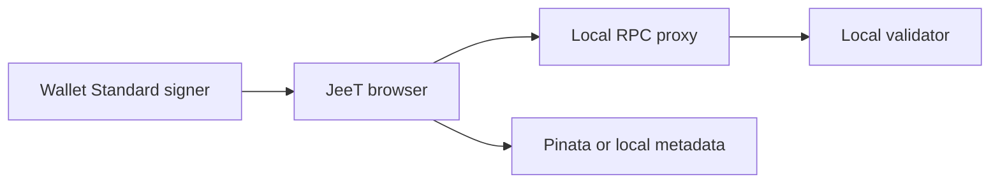
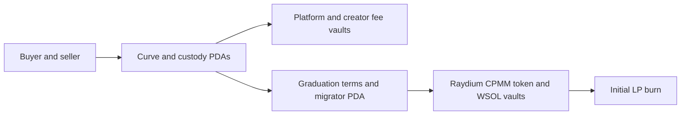

# JeeT Launch local security review handoff

See the [current V6 release candidate](RELEASE-CANDIDATE.md) for scalable discovery, updated market and wallet evidence, and release requirements.

## Review scope

Review the exact release commit, pinned Rust and npm lockfiles, and locally built SBF digests. The previous public-cluster readiness review is in [Devnet acceptance](DEVNET-ACCEPTANCE.md). This handoff describes the existing local protocol and its latest data-read path. It is an internal review aid.

## Architecture and custody





- The launch custody PDA binds the mint, creator and associated token vault. The curve PDA holds SOL redemption backing. Opening and wallet receipt PDAs enforce slot windows and cumulative buying restrictions. See [V5 ABI and integer math](../master/v5-rising/EXECUTION.md) and [custody layout](../launch-custody.md).
- Curve buys add the pre-fee curve cost to backing and separate platform/creator fees into their assigned vaults. Sells redeem against backing. Fee claims require the immutable beneficiary and advance the withdrawn counter. Review [fee ABI](../fee-engine.md) and [financial threat model](../master/authority-and-threat-model.md).
- Graduation requires the registered terms, expiry of opening restrictions, reconciled backing and inventory, and eligible curve state. Atomic execution initializes the pinned CPMM pool, deposits the reserved tokens and SOL, burns the initial LP allocation and closes migration accounts. Verified terms record the pool, slot, deposits and initial burn. Later LP issuance and external program authority are separate risks. See [Milestone D](MILESTONE-D-LOCAL-GRADUATION.md) for transaction evidence and reconciliation.
- The default program, local-fixture program, and Devnet build profile have distinct identities and gating. A production authority review should document signing custody, upgrade authority, operational recovery and incident response before any deployment. See [operations](../master/operations.md).

## Data and security boundaries

- Local discovery validates canonical custody, terms, mint, curve and metadata accounts at confirmed commitment. It is a bounded RPC snapshot with a five-second cache and a visible read timestamp. Discovery pages from a mint anchor in the selected view, with a first-page recovery when the anchor is no longer present. Live ranking changes can move items between pages. No persistent or public-cluster index is configured. Trending represents cumulative curve turnover.
- Curve history reads program-attributed events and verifies arithmetic and mint identity. Raydium history recognizes top-level base-input swaps against the verified graduation pool with canonical account roles, two scoped SPL Token transfer-checked instructions, exact input and minimum output. Each swap is identified by signature and instruction index. Curves and AMMs have separate charts. Both history windows page by RPC signature cursor and reconcile against confirmed transaction slots. Unsupported Raydium routes, missing inner-instruction data and unconfirmed activity produce no trade record. This is not a durable event index, volume oracle or finalized ledger.
- The signing proxy is loopback-gated, checks genesis and restricts RPC calls. Wallet Standard keeps signing in the wallet. Audit pending transaction reconciliation, duplicate submit handling, account switches and origin/network binding. Local test endpoints and publicly reproducible fixture signers must stay isolated from shared deployments.
- Pinata credentials remain server-side. Images and metadata can come from an external service. Independently review upload limits, malicious metadata, gateway availability, XSS, untrusted links and dependency exposure.
- Review arithmetic boundaries and liabilities, CPI account aliases and substitutions, replay and duplicate migration, stale quote and graduation races, receipt and fee beneficiary substitution, and partial failure rollback. Include the exact external CPMM binary and upgrade authority in the review. A verified initial burn is evidence about the initial LP units only.

## Reproduce the checks

From `jeet-app-next`, restore the pinned tools with `bash scripts/recover-solana-tools.sh` and source `scripts/solana-tools-env.sh`. Build the standard and local fixture SBFs using the commands in [verification](../master/verification.md). Run expensive SBF builds sequentially because Cargo's Solana toolchain alias is shared. Recover the verified Metaplex clone with `npm run metadata:recover:local` and build pinned Raydium with `npm run amm:build:local`.

```sh
npm run build
npx tsc --noEmit
npm run lint
npm run test:local
npm run test:v5:local
npm run test:graduation:local
npm run test:amm:cpmm
node --test scripts/test-release-data.mjs scripts/test-wallet-infrastructure.mjs scripts/test-wallet-amm.mjs
node --test scripts/test-release-browser.mjs
JEET_BROWSER_LOCAL_METADATA=1 JEET_BROWSER_GRADUATION=1 JEET_RELEASE_BROWSER=1 npm run test:wallet:creation:browser
```

Use separate disposable validator ledgers and Wallet Standard harness identities. Preserve command exit codes, binary digests, signatures and accounting snapshots. Genuine installed Phantom and Solflare, shared Devnet, public indexing, and independent review remain release gates. See [release readiness](RELEASE-READINESS.md) for the preceding evidence and [Devnet acceptance](DEVNET-ACCEPTANCE.md) for installed-wallet procedures.

## Local release evidence

[Lifecycle signatures and accounting](local-release-lifecycle.json) record 27 positive and 24 rejection groups at 390px, 768px and 1440px. All three runs used genuine local-validator transactions with disposable wallet harness identities and local-workspace metadata. Milestone D records the separate live Pinata test. Public navigation, responsive Explore, retry and signing-gate smoke tests passed at 390px, 768px and 1440px.

Each launch issued 1,000 base units. Graduation deposited 396 token units and 50,192 lamports, burned 4,358 initial LP units, and left zero initial LP supply. The AMM buy exchanged 1,000 lamports for 7 token units and the sell exchanged 10 token units for 1,157 lamports. The pool ended at 399 token units and 50,035 lamports. Wallet and pool token balances reconciled to 601 + 399 = 1,000. Each creator claimed 3 lamports before graduation. The browser verified both AMM transaction signatures appeared in confirmed Raydium activity and each creator claim appeared in confirmed claim history.

Fresh builds used the locked dependency graph and restored Agave 2.3.13. Frontend production build, TypeScript, ESLint, 37 targeted JS/SDK cases and six public-gating cases, 17 native Rust cases, and standard and local-fixture SBF builds passed. Fresh Raydium SBF from pinned commit `f4b9b26342afe9122d5ff67cd7a4f19ded4ac0a5` had SHA-256 `a33db1186011da4b21a09c240116a49066cc35baaa7b546cc93a42922c53f614`. This digest differs from the prior milestone artifact. The lifecycle evidence is for the freshly built binary. npm audit found no production advisories and eight moderate development-only advisories.

The standalone V5, graduation, and CPMM runners all exited 0. V5 passed 25 positive groups, 42 on-chain rejection/rollback checks and seven corrupt-account integrity fixtures. Graduation passed 28 positive and 52 rejection groups, including competing permissionless graduation transactions. CPMM passed four positive and eight rejection groups, including failed LP burn rollback, remint/withdrawal rejection, stale quotes and exact post-swap conservation. A 64-launch fixture traversed the complete local discovery capacity using mint cursors without duplicates.

The complete legacy runner (`npm run test:local`) exited **0**. It covered allocation, custody, wallet caps, deterministic curve pricing, protected opening, fee custody and claims, and both V4 market variants. Protected opening passed 14 positive, 28 on-chain rejection and nine API rejection cases. The two fee variants reported 22/52 and 24/52 positive/rejection groups. The two V4 market variants reported 62/37 and 63/37, including concurrent buyers, concurrent sellers and mixed-side races. The final protected, fee and market integrity checks passed. Log SHA-256: `94a8192334a5adc389e9479990b55f0af180cdad6fad91375b23f8f6841ea11f`.
